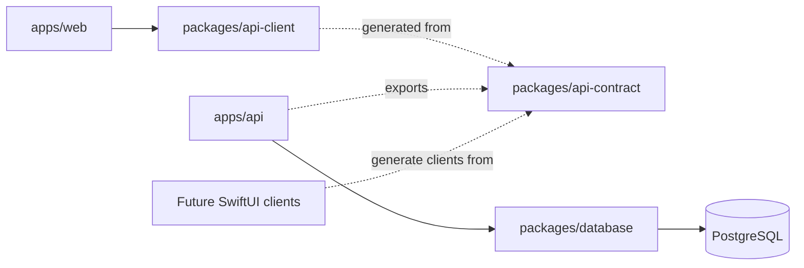

# Architecture

StudyPal starts as a web client and a modular monolith. One API deployment and one
PostgreSQL database keep transactions, operations and solo development manageable.
Scaling is a measured response to workload, not a promise made by the folder tree.

## Repository map

```text
.
├── apps/
│   ├── web/                         # React + Vite deployment
│   │   ├── src/
│   │   │   ├── app/                 # Shell, composition, error boundary, styles
│   │   │   ├── features/            # Capability-specific UI and hooks, added as needed
│   │   │   ├── components/ui/       # Local shadcn/ui source
│   │   │   ├── lib/                 # Client, environment, web-only helpers
│   │   │   └── test/                # DOM test setup
│   │   └── components.json         # shadcn configuration
│   └── api/                         # NestJS + Fastify deployment
│       ├── src/
│       │   ├── config/              # Validated startup configuration
│       │   ├── platform/            # HTTP policies and database lifecycle
│       │   ├── modules/health/      # Health and readiness probes
│       │   └── scripts/             # Offline OpenAPI export
│       └── test/                    # HTTP integration and configuration tests
├── packages/
│   ├── api-contract/                # Generated OpenAPI, usable from any language
│   ├── api-client/                  # Generated types + framework-free fetch client
│   ├── database/                    # Pool, Drizzle schema, migration runner, SQL
│   │   ├── src/schema/              # Tables grouped by owning domain when introduced
│   │   ├── migrations/              # Reviewed, versioned SQL and Drizzle metadata
│   │   └── test/                    # Unit and real PostgreSQL integration tests
│   └── typescript-config/           # Strict Node and React compiler settings
├── docs/architecture/               # Decisions, data plan, operations
├── infra/docker/                    # Local PostgreSQL only
├── scripts/                         # Repository automation
├── .github/                         # CI and dependency updates
└── AGENTS.md                        # Predictable instructions for future coding agents
```

No iOS/macOS projects, worker service, generic utilities package, Redis, vector
service or cloud deployment scaffolding is created before it is needed. Shared UI
stays in the only web app; it can become a package if a second React app needs it.

## Local Mac deployment

The built React app uses Clerk by default. After verifying a Clerk session, the API binds the issuer and user ID to a PostgreSQL owner. Browser workspace and audio databases are scoped to that owner. The app saves edits in IndexedDB and syncs versioned snapshots to PostgreSQL. The explicit local mode keeps the original single-owner pairing scope for offline-only installations and recovery. The lecture recorder keeps audio blobs in origin-specific browser storage and can back them up in owner-scoped chunks to PostgreSQL. Local inference goes directly to Ollama on loopback. Optional remote assessments are owner-scoped, budgeted PostgreSQL jobs processed outside HTTP request handlers. See the [run commands](../../README.md) and [server contract](../../apps/api/README.md).

## Dependencies



The generated contract is a build artifact, not a backend TypeScript dependency
for the browser. Packages never import apps. Domain code cannot import frameworks
or infrastructure. Cross-feature calls go through public module entrypoints, not
table access or internal repositories. Dependency Cruiser enforces directions,
cycles and feature encapsulation; the architecture still requires review of query
ownership and runtime behavior.

A substantial future module uses:

```text
modules/materials/
  index.ts                         # Public module/provider exports
  materials.module.ts              # Nest dependency composition
  domain/                          # Entities, value objects, pure policies
  application/                     # Use cases and required ports
  infrastructure/                  # Drizzle queries, storage/provider adapters
  presentation/                    # Controllers and request/response DTOs
```

Do not impose these layers on a simple health endpoint. Pure application services
receive dependencies through constructors; Nest wiring belongs in module factories
when keeping use cases framework-free matters. A few explicit ports are preferable
to a repository base class or a mandatory interface for every class.

## Contract strategy

Explicit Nest DTO metadata and validation are the authoring source. Offline export
produces OpenAPI and `openapi-typescript` produces client types; `openapi-fetch`
provides the transport. CI regenerates both and fails on drift. Export opens no
database connection. API shapes are independent of ORM models. Stable operation
IDs, UTC ISO timestamps, opaque string IDs and additive evolution make the same
REST API suitable for Swift-generated clients later.

Use `/api/v1`; preserve old versions during native app upgrades. Add contract
compatibility review before the first external release. Streaming tutoring can
later use documented SSE events, cancellation and reconnect semantics without
changing the REST resource model. No TypeScript-only RPC contract is required.

## Runtime and performance

The web shell renders without API calls. Keep filtering, presentation, editor
state and derived UI calculations local when datasets are bounded. Authoritative
ownership, persistence, secrets, AI quotas and validation remain server concerns.
Introduce route splitting, server-state caching, virtualization and Web Workers
when their actual features require them; do not add those dependencies preemptively.

Compile server packages with `tsc` to preserve Nest decorator metadata; compiled
workspace packages also run under plain Node. The browser client is ESM and
tree-shakeable. Turborepo caches builds with declared outputs and public build-time
environment inputs; database integration tasks are never cached.

API replicas are stateless with bounded pools, body limits, timeouts and graceful
shutdown. Cache static hashed assets at the CDN, serve HTML with revalidation, and
route `/api` to the API. Shared rate limits and connection pooling become deployment
concerns as replicas grow; the initial in-process limiter is not a global quota.

See [Data and AI](data-and-ai.md) for schema/processing design and
[Operations](operations.md) for security and deployment requirements.

## References

- [Turborepo internal packages](https://turborepo.dev/docs/core-concepts/internal-packages)
- [Nest OpenAPI](https://docs.nestjs.com/openapi/introduction)
- [OpenAPI TypeScript](https://openapi-ts.dev/introduction)
- [Drizzle migrations](https://orm.drizzle.team/docs/migrations)
